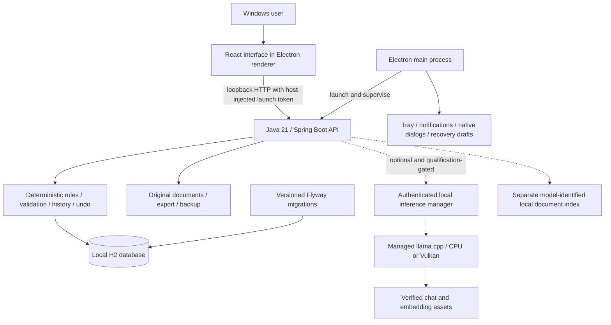

# Folio

**A local Windows workspace for tasks, notes, study, and personal planning.**

Folio brings a task board, calendar, rich-text notes, academic grades, habits, career applications, and local documents into one workspace. Its Java backend owns exact records and calculations; an experimental assistant is being developed for reviewed changes and document-grounded answers.

**Status — 20 October 2026:** Windows desktop beta. Core workflows, recovery, and isolated installer upgrades have recorded acceptance evidence, and fresh automated checks pass. The latest notification fix still needs a physical click retest and a matching refreshed installer. **AI remains disabled in ordinary builds, and model training is paused.**

[Features](#features) · [Architecture](#how-it-works) · [Run locally](#run-locally) · [Verification](#verification-and-release-status) · [Documentation](#documentation)

## Features

- **Tasks:** List and Board views, one level of subtasks, tags, priorities, filters, recurring schedules, and archive/restore.
- **Calendar:** Month, week, day, and agenda views combining task deadlines, assessments, and standalone events. Editors and drag rescheduling preserve event duration and reminder offsets.
- **Notes:** Headings, formatting, lists, checklists, safe links, pinning, tags, autosave, revision conflicts, recovery drafts, and Markdown export.
- **Today and progress:** Overdue/current work, events, assessments, habit check-ins, and 7-day/30-day summaries.
- **Academics:** Courses, assessment categories, scores, weighted grades, and required-final-score calculations.
- **Career and habits:** Application stages, scheduled habit check-ins, and calendar-day streaks.
- **Search:** Keyboard-accessible search across tasks, notes, events, courses, applications, and document filenames.
- **Documents:** Store PDF and Markdown originals locally and download original bytes without an AI key.
- **Windows integration:** System tray, optional startup with Windows, and native reminders while the app remains running.
- **Data tools:** Checksummed complete backups, staged restore with recovery, structured exports, and change history with guarded undo.
- **Preferences:** Workspace timezone, Sunday/Monday week start, display name, and reminder settings.

Academics, Career, and Personal are explicit data areas. The combined Academics/Career view excludes Personal; viewing Personal requires selecting it. The desktop core runs without a cloud account, API key, or separate database server.

## Preview

Screenshots use sample records from a disposable workspace.

### Task board


### Calendar


### Notes


## How it works



The React interface runs in a sandboxed Electron renderer. Electron launches the bundled Java backend on `127.0.0.1` with a dynamic port and a new secret for each launch. The host attaches that secret to backend requests. The renderer has no Node access; a narrow preload bridge exposes approved desktop operations.

The backend validates scope, relationships, dates, revisions, and mutations before writing records. Grades use `BigDecimal`; streaks and recurrence use calendar/timezone rules. History and guarded undo protect against overwriting later edits or deleting an edited recurring successor. None of these calculations requires a language model.

Documents are stored independently of AI. The RAG implementation combines semantic embeddings with BM25 keyword search using reciprocal rank fusion (`k=60`), returning source/page metadata. Experimental desktop indexing uses a separate embedding namespace so incompatible new vectors do not overwrite legacy indexes. Ordinary desktop builds store originals with automatic indexing disabled.

Natural-language actions follow **request → validated proposal → user review → confirmed save**. A document passage is evidence for answering, never authorization to change records. Model availability and quality are separate from core-app readiness.

### Technology stack

- **Interface — React 19.3, Vite 8.3, JavaScript/JSX, CSS:** reusable workspace components and production assets.
- **Notes — Tiptap/ProseMirror:** structured rich-text editing, lists, and checklists.
- **Desktop — Electron 44.7 and Node.js:** Windows integration, backend ownership, native dialogs, notifications, and stable draft storage.
- **Backend — Java 21, Spring Boot 3.3.5, Spring Data JPA, JDBC, validation:** transactional records and deterministic business rules.
- **Local storage — H2 and Flyway:** a file-backed database without a separate service, with explicit upgrade migrations and schema validation.
- **Documents/retrieval — PDFBox 3.0.3, custom Markdown parsing, Caffeine, BM25, and rank fusion:** page-aware extraction, bounded embedding caching, and hybrid retrieval. The original ingestion path parallelizes embeddings with Java virtual threads.
- **Experimental AI — Qwen3 4B, Nomic Embed Text v1.5, llama.cpp:** pinned assets for managed on-device inference; Python/PyTorch/PEFT/bitsandbytes provide developer-only QLoRA training tools.
- **Packaging — Electron-builder, bundled Temurin Java 21, and Inno Setup:** unpacked Windows applications and the private-beta installer path. A small C# Job Object host contains inference processes.

PostgreSQL/pgvector, Supabase, Gemini, Docker, Vercel, Render, and browser-push code remain from earlier deployment work. They are **not prerequisites for the current desktop edition**. See [the analysis paper](docs/PROJECT_ANALYSIS_PAPER.md) for the technology rationale, evolution, and implementation limits.

## Run locally

The desktop build targets **Windows 11 x64**. Development requires **JDK 21+**, **Node.js 22.12+**, npm, and Git. Initial dependency/runtime preparation requires internet access; the prepared core app uses bundled resources. End users of a packaged build do not need Java, Node, Python, Docker, or an AI key installed separately.

From PowerShell:

```powershell
git clone https://github.com/ravenz0903/personal-rag.git
Set-Location personal-rag
npm --prefix frontend ci
npm --prefix desktop ci
npm --prefix desktop run prepare
npm --prefix desktop start
```

`prepare` builds the backend JAR and frontend assets, stages them under `desktop/resources`, and downloads/verifies the pinned Java runtime. It skips backend tests; run the checks below separately. With no qualified AI assets staged, the workspace starts with AI disabled.

Development and packaged launches normally share `%APPDATA%/Folio`. To try the app in a separate workspace, replace the final command above with:

```powershell
$folioDevData = Join-Path $env:TEMP 'folio-dev-workspace'
npm --prefix desktop start -- --user-data-dir="$folioDevData"
```

For separate backend/frontend development, use two terminals from the repository root:

```powershell
# Terminal 1: development backend, loopback port 8080
.\mvnw.cmd spring-boot:run
```

```powershell
# Terminal 2: Vite interface, with /api proxied to the backend
npm --prefix frontend run dev
```

This separate development mode uses the repository's ignored `data/` directory and differs from the desktop runtime. [DESKTOP.md](DESKTOP.md) explains desktop behavior, data locations, migration, and recovery.

### Build an unpacked Windows app

```powershell
npm --prefix desktop run package
```

The unpacked application is written under `desktop/release/win-unpacked`. A successful build is not an installer acceptance result.

The private **AI-enabled** installer script requires a qualified export and verified runtimes/licenses. Once those exist, run the release workflow with the actual qualified directory under `target/`:

```powershell
node desktop/scripts/build-beta.cjs target/qualified-export
```

`target/qualified-export` is an example path, not a supplied model. That workflow uses Inno Setup and writes to `target/private-beta`; it currently has no qualified chat export to consume. Running bare `npm run dist` is not a shortcut around the qualification gate. The core-only QA installers described in the verification log are separate acceptance artifacts, not a published stable release.

## Data, privacy, and recovery

The default desktop workspace is `%APPDATA%/Folio`; Settings → **Open data folder** shows the actual location. An explicit `--user-data-dir` selects another workspace.

```text
Folio/
├── data/
│   ├── tracker.mv.db          # saved records and history
│   ├── documents/            # original uploaded files
│   └── migration-backups/    # pre-migration database backups
├── note-drafts/              # unsaved recovery drafts
├── restore-backups/          # recovery backups made during restore
└── data-before-restore-*/    # retained previous data, when present
```

Complete backups include the database and originals with a checksum manifest. Restore validates the archive in staging, creates recovery material, and restarts the backend against restored data; failure and interruption paths retain recovery copies. Unsaved note drafts have separate local recovery storage and are archived during restore. Structured exports contain records, Markdown notes, and a document manifest; use **Save backup** for complete saved-workspace recovery.

Local storage, exports, and backups are **not encrypted by Folio**. Area scoping and the desktop API secret do not protect files from another process running as the same Windows user. Installers and application data live separately, and isolated upgrade/uninstall/reinstall checks have verified data preservation for the tested builds.

Closing the window keeps Folio in the tray. **Quit Folio** stops the backend and reminders. Reminders need Folio running and the computer awake; wake/restart catch-up is limited to the previous 24 hours. Windows notification settings affect visibility, and a crash between display and acknowledgment can produce a duplicate.

## Verification and release status

Fresh checks on **20 October 2026** passed:

- Backend: **487 tests**, zero failures/errors/skips.
- Desktop: **33 tests**, zero failures.
- Frontend: **9 tests**, zero failures, plus a successful production build.
- Training utilities: **13 tests**, plus **21 contract-v2/Colab tooling tests**, zero failures. These test tooling; they do not train or qualify a model.

Run the same core checks from the repository root:

```powershell
.\mvnw.cmd test
npm --prefix desktop test
npm --prefix frontend test
npm --prefix frontend run build
python -m unittest discover -s training -p 'test_*.py'
```

Additional Colab/tooling tests under `training/colab` use the developer training environment; see [training documentation](training/colab/README.md). After preparing desktop resources, `node desktop/scripts/smoke.cjs` exercises bundled Java, API authentication, original storage, backup, and shutdown in a disposable workspace. Real UI, notification activation, restore-interruption, executable, and installer harnesses live under `desktop/scripts`.

Recorded checks also cover real sandboxed Electron workflows, forced restart persistence, note-draft recovery, native export failures/retries, restore rollback, reminder cancellation, and installed upgrade/uninstall/reinstall. These checks are described with their scope and build identity in [VERIFICATION.md](VERIFICATION.md).

**Remaining gates:** human notification click acceptance on the corrected package G, completion of partial offline/device observations, a refreshed installer matching that source, broader usability/hardware review, and final evidence audit. Earlier package F installer acceptance does not certify package G. Passing automated tests does not establish physical sleep/wake or visible notification behavior.

## Experimental local AI

The intended assistant proposes reviewed task/calendar changes and answers from local documents. Backend guards require explicit scope, selected targets for edits, trusted date resolution, revision checks, and confirmation before saving.

Qwen3 4B adapters are still experimental. The latest fully evaluated candidate, **V19**, scored **82/100 on fresh qualification v6**, with zero flagged unsafe proposals on that set, below the **95/100 with zero unsafe proposals** release gate. Historical regression results and manual factual review also exposed failures. Earlier **83/100** results belong to V7 and are not the latest candidate score.

**V20 is incomplete; training is paused.** There is no qualified merged/GGUF chat export and no enabled ordinary-build assistant. Small synthetic checks and finite-set scores are not accuracy guarantees. The planned offline AI package bundles verified CPU/Vulkan inference assets, chat weights, and embeddings; users should not need a separate Ollama installation or Python environment. Exact export/runtime and installed-app acceptance remain required.

See [PLAN.md](PLAN.md), [LOCAL_AI.md](LOCAL_AI.md), and [contract-v2 training notes](training/colab/README.md) for experiment history and release criteria.

## Repository layout

```text
frontend/                   React workspaces, notes, calendar, API helpers, styles
src/main/java/com/tracker/  Spring controllers, rules, persistence, retrieval
src/main/resources/        Profiles, desktop migrations, AI contract
src/test/                  Backend unit, boundary, integration, and stress tests
desktop/                   Electron host, backups, drafts, notifications, packaging
desktop/ai/                Managed inference and pinned asset/qualification locks
desktop/scripts/           Preparation, build, UI/runtime/installer acceptance
training/                  Dataset, training, evaluation, qualification, export tools
training/colab/            Portable notebooks and contract-v2 developer tooling
supabase/                  Retained cloud schema and browser-push reminder path
docs/                      Screenshots, device checks, technical analysis paper
```

Credentials, personal databases, backups, model weights, adapters, checkpoints, generated datasets, runtime bundles, and installers are excluded from Git. Evidence paths under `target/` refer to local ignored outputs and are not included in a fresh clone.

## Documentation

- [Project analysis paper](docs/PROJECT_ANALYSIS_PAPER.md): stack choices, architecture, completed work, rationale, and limitations. A [printable HTML version](docs/PROJECT_ANALYSIS_PAPER.html) is also included; download/open it locally to read or print.
- [Current plan](PLAN.md): priorities, paused training state, and remaining delivery gates.
- [Verification record](VERIFICATION.md): test results, reproduced defects, fixes, build identity, and acceptance limits.
- [Windows guide](DESKTOP.md): build/run instructions, tray behavior, storage, migration, and backups.
- [Device checks](docs/DEVICE_CHECKS.md): physical offline and sleep/wake procedure and remaining observations.
- [Local AI research](LOCAL_AI.md) and [training tools](training/README.md): experimental model work.
- [Original requirements](ORIGINAL_REQUEST.md): tracker, domain isolation, RAG, and confirmation requirements.
- [Historical cloud deployment](DEPLOYMENT.md): retained reference; not needed for desktop setup.

Cloud sync, teams/shared workspaces, external calendar integrations, automatic updates, and a public stable release remain future work.
