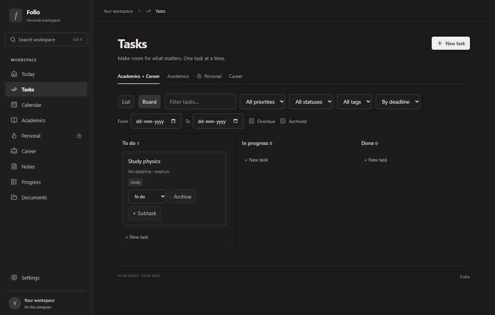
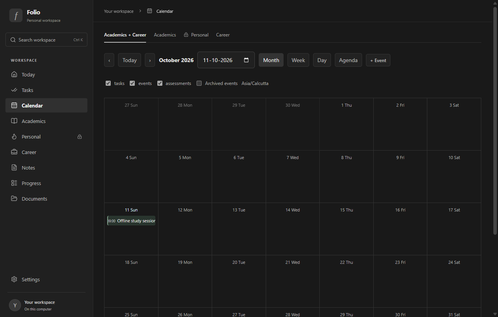
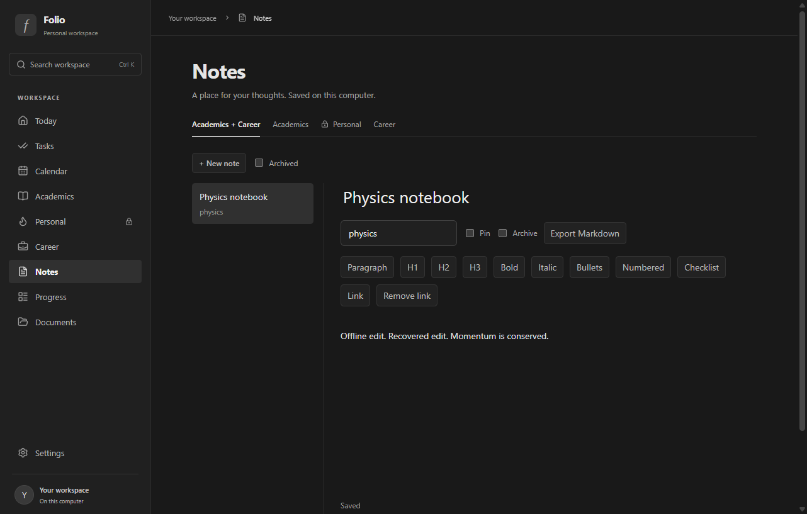

# Folio

A local Windows workspace for tasks, notes, study, and personal planning, with a minimal dark interface inspired by Notion.

**Status: Windows desktop beta in development.** The core workspace is implemented. Local AI integration and the complete offline installer are still being tested.

## Features

- **Tasks:** List and Board views, subtasks, tags, priorities, filters, recurring schedules, and archive/restore.
- **Calendar:** Month, week, day, and agenda views for task deadlines, assessments, and standalone events.
- **Notes:** Formatted writing, headings, lists, checklists, links, autosave, draft recovery, and Markdown export.
- **Today:** Upcoming and overdue work, calendar events, assessments, and habit check-ins.
- **Academics:** Courses, assessments, scores, and weighted-grade tracking.
- **Career:** Application tracking and progress through application stages.
- **Habits and progress:** Check-ins and summaries over 7-day and 30-day periods.
- **Workspace search:** Find tasks, notes, events, courses, applications, and document filenames.
- **Documents:** Local PDF and Markdown storage with original-file downloads.
- **Reminders:** Windows notifications while Folio remains running in the system tray.
- **Data tools:** Complete workspace backups, validated restores, exports, and change history with guarded undo.
- **Preferences:** Workspace timezone, calendar week start, reminder settings, and optional startup with Windows.

The desktop workspace runs locally without an account or AI API key. Personal content stays outside the combined Academics/Career view unless explicitly selected.

## Local AI development

An experimental on-device assistant is being developed for reviewed task and calendar changes, reminders, document questions, and summaries. Changes must be approved before they are saved.

Qwen3 4B fine-tuning and local document indexing are under evaluation. The latest adapter passed the 12 original checks and 16 harder probes, but scored 83/100 on a separate synthetic qualification set, below the required 95/100. AI stays disabled in ordinary builds until the model and its packaged runtime pass the release checks. These scores do not guarantee accuracy on future requests.

The intended offline package will include the required runtimes and models, with GPU acceleration and a CPU fallback. End users should not need a separate Ollama installation, Python environment, or cloud API key. That package is not ready for release yet.

## Beta screenshots

These previews use sample records from a disposable test workspace.

### Task board

### Calendar

### Notes

## Beta availability

Folio currently targets Windows 11 x64. Startup, tray operation, notification navigation, save conflicts, and backup recovery have been checked on the development laptop. Sleep/wake behavior, broader hardware compatibility, and the full offline installer lifecycle still need verification.

Reminders require the computer to be on and awake, with Folio running in the tray. Windows notification settings can affect delivery.

Local storage is not encrypted by Folio. Keep backups private.

## Repository contents

This repository contains application source, tests, build scripts, model-training tools, pinned dependency information, and sample screenshots. Model weights, adapters, checkpoints, generated datasets, local databases, credentials, and installer outputs are excluded from Git.

See [PLAN.md](PLAN.md) for the current checklist and [VERIFICATION.md](VERIFICATION.md) for recorded checks and remaining release gates.
